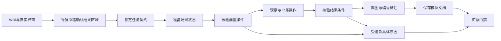

# 用户可用结果优先的快速上手 Skill 设计

唯一主要交付是普通用户能据此完成核心任务的简短图文指南，不是执行纪律清单、探索记录或验收报告。先定义受众、权限、最重要的3至5个用户目标（小范围可更少）及可用模块标准，再收集支持内容的最小必要页面证据。工具次数、检查点数量和凑齐 success/empty/error/permission 都不能衡量指南质量。

可用模块让初次使用者知道必要准备、入口层级、对象选择、关键填写、如何确认结果和会影响操作的限制，通常3至6步，配少量关键图片。每个满足门禁的模块尽早独立保存；遇阻保留已完成成果并说明限制，不为了探索或补图推迟交付、重复提交业务。

默认 `profile=general`，包括一般后台指南；仅对支撑内容的关键操作核验，可不设置中间 checkpoints。复杂业务端到端核验或明确要求深度业务验收时显式选 `profile=admin`，保留严格检查。ERP、CRM、采购和工单是可支持的目标系统，不是自动启用 admin 的理由。当前实现保留 Pi SDK 运行时，不自建 Agent 循环，不向业务 Agent 开放源码、Shell 或任意脚本执行。

## 通用边界

通用的是任务契约、探索方法、状态机、证据约束和文档出口。系统特有的是角色、业务规则、初始数据、认证和结果验证入口。Gymbook 是案例，核心模块没有预约、钱包、工单等业务判断。

| 层                  | 负责什么                                           | 迁移系统时的变化         |
| ------------------- | -------------------------------------------------- | ------------------------ |
| Skill               | 识别目标、规划场景、探索层级、分析错误、写业务说明 | 复用                     |
| 任务契约            | 角色、目标、准备方式、前置状态、结果、恢复办法     | 按当前系统生成并复核     |
| Pi hooks + 宿主工具 | 阶段约束、只读检查、证据账本、保存和汇总门禁       | 复用                     |
| 浏览器能力          | 真实层级、ref、交互、截图、画框                    | 复用                     |
| 系统适配能力        | SSO、种子、重置、后端业务验证                      | 按能力增加，当前尚未实现 |

没有专有适配器时，已有测试账号和状态仍可运行。无法准备的空态、错误态或权限态记为 blocked，不能算已覆盖。通用不意味着无需了解业务规则，也不意味着自动生成任意系统的测试数据。

## 完整技能包

```text
skills/quick-start/
  SKILL.md                       原生 Pi 入口及执行策略
  manifest.json                  包内容与宿主注册位置说明
  schemas/task-plan.schema.json  可校验契约，来自 TS 同一类型源
  references/workflow.md         断言、深度及异常处理规范
  references/admin.md            后台菜单、表格、抽屉和表单策略
  references/adapter-contract.md 后续系统适配接口与能力边界
  examples/gymbook.json          预约成功/余额不足/预约空态
  examples/helpdesk.json         工单创建/必填校验失败
  examples/admin-procurement.json 后台审批契约和中间检查点
  scripts/validate.ts            验证示例及 schema 一致性
  evals/README.md                可执行评测与真实系统验收边界
src/quick-start.ts               宿主状态机、检查器及 Pi hooks
src/artifacts.ts                 原图保留、坐标校验及编号红框
test/quick-start.test.ts         跨领域和误判回归
test/skill-outcomes.test.ts      默认深度、可用模块与未验证边界回归
test/admin-console.test.ts       复杂后台操作回归
scripts/live-admin-guide.mjs     真实模型对独立采购后台的验收
```

hook 是宿主显式注册的 Pi extension；把 `hooks.json` 放进 Skill 目录并不会自动执行。`manifest.json` 是本项目说明文件，不能冒充 Pi 配置。Skill 主文只保留交付目标、范围和必要底线，参数与执行细节通过白名单 `quick_start_reference` 按需读取：workflow 解决参数/证据问题，admin 提供复杂后台策略，不强制每次先读全部资料，也不需要通用 read 工具。

## 任务编排



模块按用户任务组织，场景按初始状态和分支组织。不是把菜单点击一遍。比如“提交工单”须核对本次唯一标记、标题和待处理状态；“余额不足预约”须核对错误与无新增记录，不能仅以一次成功 toast 作为证据。

一个计划含1至8个模块，每模块1至4个场景，这是容量边界，不是覆盖数量目标。围绕重要用户目标选择相关路径，`coverageReason` 说明实际选择、验证范围和缺口，不强行凑齐 success、empty、error、permission。每场景有 setup、preconditions、goal、outcomes、cleanup。省略 profile 时宿主校验和保存都采用 general，不要求机械的2个 checkpoints，仍核验前置状态、目标条件并归档结果图；general 不是仅限只读任务。显式 admin 保留成功场景至少2个 checkpoints、其他分支至少1个的严格门禁。两个模式中已规划的检查点都必须按顺序核验、截图，再继续；最终结果另行验证。cleanup 是计划描述，不代表已执行清理。

声明式 UI 检查支持语义定位、testId 和 CSS，检查可见、隐藏、字段值、启用/禁用、勾选状态、文本和数量。否定条件要求唯一、可见的父范围，避免空页面假通过；正向目标必须唯一，避免把另一对象当成本次结果。匹配不唯一应改进契约，不能默认取第一条。

契约执行后锁定，Agent 不能为了通过而降低标准。宿主生成证据 ID、检查时间和受控浏览器动作版本；模型不能提交 passed。验证后继续操作会撤销当前证据。切换下一场景前必须先截图，通过 prepare 封存上一场景证据。

## hooks 与工具职责

| 入口                | 行为                                                                                                      |
| ------------------- | --------------------------------------------------------------------------------------------------------- |
| before_agent_start  | 从宿主恢复当前契约和场景状态，补充上下文                                                                  |
| tool_call           | 拦截无计划的业务操作、缺证据的文档、跨模块或不完整汇总；契约前允许受限导航探路                            |
| tool_result         | 记录工具名、是否失败并保存工作流状态；不把“工具未报错”解释成业务成功                                      |
| agent_before_settle | 保存状态；未完成且预算允许时由 Pi 原生机制最多续跑2次，取消/错误/全场景受阻不续跑；仍无汇总时按未完成报告 |
| 工具实现            | 再次检查门禁，避免仅依赖 hook；只读检查器决定指定条件是否成立                                             |

Pi 负责多轮、工具调度、流式输出、取消与上下文管理。host 负责真实状态与产物约束。未增加另一套循环或无限补跑 hooks。

每个已验证场景归档各组结果验证后的图片，已规划的中间检查点也必须归档截图；不要求 general 为凑数创建检查点。模块所有场景已核验或明确受阻且至少一个场景有完整证据时立即保存，readyModules 提供合法图片，不为补图重复操作。用户导出只展示能支持操作的少量关键图，通常3至6步；验证过程、引用和全部证据保留在 JSON。图片可由原始截图或派生标注图提供；标注使用该截图保存的坐标和 ref，不使用后来页面的位置。保留原图与 sourceId，校验项目、会话、浏览器、模块、边界及编号说明。

## 证据能力和限制

目前 `verificationLevel=ui-checks`，`contractReview=draft`。这表示指定 UI 条件成立，不等于业务规则正确、数据已持久化、后台结算正确或权限隔离通过审计。Agent 仍可能制定过弱契约，人工复核和语义评测必须检查这一点。

不为生成指南冒险修改业务数据；只用授权账号和数据，不重复创建或提交。不具备安全提交条件时，锁定前可选择已观察的查询、定位或填写准备作为独立目标，并在 goal、coverageReason 和指南中写清范围：“未实际提交，业务结果未验证”。核验表单就绪不能声称提交成功；实际提交后仍须核对同一对象的关键字段和状态，toast 不足以证明业务结果。锁定后无法完成的提交场景标受阻，不能降低条件或编造结果。

产物保留条件、检查结果、证据 ID、页面和图片。模块内未完成场景会阻止写文档；明确受阻场景允许输出部分草稿，且在导出文件中展示缺口。全部场景受阻的模块不能伪造文档，只能说明跳过。

状态账本当前保存于本地，Pi 会话仍是内存会话；服务重启后的自动恢复、跨角色独立会话、状态种子和可信后端断言尚待实现。受控动作版本不等于数据库事务版本。源代码变化检测、视觉回归同步不在本轮范围。

## 参考与取舍

| 原始项目                                                                                                                                      | 采用的机制                            | 不直接套用的部分                                         |
| --------------------------------------------------------------------------------------------------------------------------------------------- | ------------------------------------- | -------------------------------------------------------- |
| [Pi protected-paths extension](https://github.com/earendil-works/pi/blob/v1.4.0/packages/coding-agent/examples/extensions/protected-paths.ts) | tool_call 事件拦截，宿主显式注册      | 路径保护示例本身不懂业务完成条件                         |
| [Vercel agent-browser Skill](https://github.com/vercel-labs/agent-browser/blob/main/skill-data/core/SKILL.md)                                 | snapshot/ref/act 循环，编号截图和图例 | 继续复用现有 Pi + Playwright，不引入第二套浏览器 CLI     |
| [Anthropic webapp-testing](https://github.com/anthropics/skills/blob/main/skills/webapp-testing/SKILL.md)                                     | Skill 配套脚本与实例、渲染后观察      | 不加入目标源码读取；等待具体状态，不统一依赖 networkidle |
| [Superpowers verification-before-completion](https://github.com/obra/superpowers/blob/main/skills/verification-before-completion/SKILL.md)    | 完成前取得新证据                      | 原文是行为约定，本项目补充宿主检查和门禁                 |

[Superpowers hooks](https://github.com/obra/superpowers/blob/main/hooks/hooks.json) 的 SessionStart 用于加载引导，不能据此认为它已验证业务成功。借鉴分工和可执行资源，不照搬其他运行时配置。

## 验收与后续

已提供预约、工单两类本地浏览器夹具，使用同一运行时验证正常和错误路径；反例覆盖 toast-only、错误对象、空页面假通过、验证后操作、图片缺失和跨浏览器标注。实际 Pi 协议测试验证 hook 在工具处理器之前拒绝伪造文档。

示例 JSON 的定位器是教学数据，不能当作真实系统已经通过。复杂后台提供有独立HTTP后端的采购审批验收服务，涵盖三级菜单、分页筛选、同名行操作、抽屉、虚拟明细滚动、联动表单、校验、确认及刷新核对。采购后台是代表性测试实现，不代表任意 ERP 产品已验收。可靠自动回放优先实现 capability-based 种子/重置适配器及清理报告；随后加入可信业务断言。更长提示词不能替代这些能力。

## 大页面观察

快照优先活动弹窗、抽屉、下拉及行菜单，同时保留区域入口。大表格默认切片；browser_table 按唯一标识读取当前已渲染行及其控件，返回列、范围和是否还有窗口。分页和虚拟滚动不会冒充全量搜索。browser_act(scroll) 可指定区域与横纵轴；browser_wait 等待明确条件并刷新快照，不生成业务完成证据。表单提供只读、必填、错误、禁用说明和原生下拉选项。

## 指南后的 QA

指南汇总后，宿主启动独立的原生 Pi 会话，仅提供 qa_write，从已保存模块整理问答；沿用管理员 LLM 配置，不再探索网页。每模块1至3条、总计最多20条，继承对应模块的引用与指南来源。整理后是否可复用由宿主 QA 准入策略决定，Skill 不承载或重复定义该策略。生成状态持久化，失败保留指南和已有条目，可单独重试；同指南并发合并、规范化问题去重，重试不覆盖已有审核结果。
